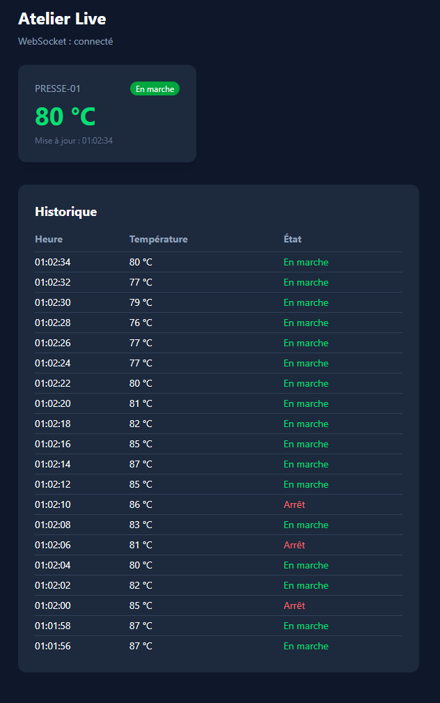
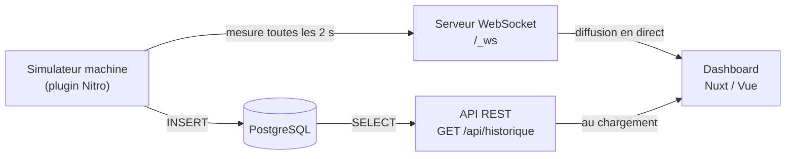

# Atelier Live


Mini tableau de supervision industrielle en temps réel : une machine de production (simulée) envoie ses mesures toutes les 2 secondes, elles sont enregistrées dans PostgreSQL et diffusées en direct sur un dashboard via WebSocket.

Projet réalisé pour découvrir la stack **Nuxt / Vue 3 / TypeScript / PostgreSQL / WebSocket / Docker**, dans un contexte proche de la supervision de lignes de production.



## Fonctionnalités

- Affichage en temps réel de l'état d'une machine (température, en marche / à l'arrêt)
- Code couleur selon la température : bleu (< 40 °C), vert, rouge (> 80 °C)
- Historique des 20 dernières mesures, chargé depuis la base puis mis à jour en direct
- Reconnexion automatique du WebSocket avec rattrapage des mesures manquées
- Pipeline CI : vérification TypeScript et build à chaque push

## Stack technique

| Domaine          | Technologie                                   |
| ---------------- | --------------------------------------------- |
| Front-end        | Nuxt 4, Vue 3 (Composition API), Tailwind CSS |
| Back-end         | Nitro (serveur Node intégré à Nuxt)           |
| Langage          | TypeScript, de bout en bout                   |
| Temps réel       | WebSocket                                     |
| Base de données  | PostgreSQL 17 (client `postgres`)             |
| Conteneurisation | Docker Compose                                |
| CI               | GitHub Actions                                |

## Architecture



- **Le passé** arrive par l'API REST, une fois au chargement de la page.
- **Le présent** arrive par le WebSocket, en continu.

## Structure du projet

```
atelierlive/
├── app/
│   ├── app.vue                  # Dashboard (carte machine + historique)
│   └── assets/css/main.css      # Point d'entrée Tailwind
├── server/
│   ├── api/historique.get.ts    # GET /api/historique
│   ├── plugins/simulateur.ts    # Fausse machine : génère, diffuse et enregistre les mesures
│   ├── routes/_ws.ts            # Point d'entrée WebSocket
│   └── utils/
│       ├── db.ts                # Connexion PostgreSQL (instance unique)
│       └── peers.ts             # Liste des clients WebSocket connectés
├── shared/types/mesure.ts       # Type Mesure, partagé entre serveur et front
├── init.sql                     # Création de la table et de l'index
├── docker-compose.yml           # Base PostgreSQL
└── .github/workflows/ci.yml     # Pipeline CI
```

## Installation

### Prérequis

- Node.js 24 (LTS)
- Docker Desktop

### Lancer le projet

```bash
# 1. Cloner le dépôt
git clone https://github.com/TON-PSEUDO/atelierlive.git
cd atelierlive

# 2. Installer les dépendances
npm install

# 3. Créer le fichier d'environnement
cp .env.example .env        # sous Windows (PowerShell) : copy .env.example .env

# 4. Démarrer PostgreSQL (la table est créée automatiquement au premier lancement)
docker compose up -d

# 5. Lancer l'application
npm run dev
```

Le dashboard est disponible sur http://localhost:3000.

### Commandes utiles

| Commande                 | Rôle                                          |
| ------------------------ | --------------------------------------------- |
| `npm run dev`            | Serveur de développement                      |
| `npm run build`          | Build de production                           |
| `npm run typecheck`      | Vérification TypeScript de tout le projet     |
| `docker compose stop`    | Arrêter la base (les données sont conservées) |
| `docker compose down -v` | Supprimer la base et ses données              |

## Choix techniques

**Un type partagé de bout en bout.** Le type `Mesure` est défini une seule fois dans `shared/` et utilisé par le simulateur, l'API et le dashboard. Si sa forme change, TypeScript signale tous les endroits à adapter.

**Diffusion avant enregistrement.** Chaque mesure est d'abord envoyée aux écrans, puis enregistrée en base. L'opérateur voit la valeur sans attendre la base, et une panne de PostgreSQL n'interrompt pas la supervision en direct.

**Conversion SQL ↔ application à un seul endroit.** La route API traduit les colonnes SQL (`en_marche`, dates `TIMESTAMPTZ`) vers le format de l'application (`enMarche`, chaînes ISO). Le front reçoit des données propres.

**Un index adapté à la requête principale.** L'index `(machine, at DESC)` correspond exactement à la requête « dernières mesures d'une machine ». À raison d'une mesure toutes les 2 secondes (plus de 40 000 lignes par jour et par machine), il évite de parcourir toute la table.

**Reconnexion automatique avec backoff exponentiel.** Si la connexion tombe, le dashboard réessaie après 1 s, 2 s, 4 s… jusqu'à 30 s maximum. À la reconnexion, l'historique est rechargé depuis l'API pour combler le trou.

**Requêtes préparées.** Les requêtes SQL utilisent des _tagged templates_ : les valeurs sont transmises séparément du texte de la requête, ce qui empêche les injections SQL.

## Limites et pistes d'amélioration

- **Valider les messages reçus** : `JSON.parse(...) as Mesure` n'est pas vérifié à l'exécution. Une validation (par exemple avec Zod) sécuriserait les données entrantes.
- **Connecter une vraie source industrielle** : remplacer le simulateur par la lecture de variables via OPC-UA (bibliothèque `node-opcua`).
- **Gérer plusieurs machines** : une carte par machine et une route API paramétrée.
- **Graphique d'évolution** de la température dans le temps.
- **Alertes** en cas de dépassement de seuil prolongé.
- **Tests automatisés** (Vitest) intégrés à la CI.
- **Conteneuriser l'application** elle-même avec un Dockerfile, pour un déploiement complet via Docker Compose.

## Auteur

Florian, étudiant en Bachelor Smart Developer à Metz Numeric School, en recherche d'alternance en développement web.
